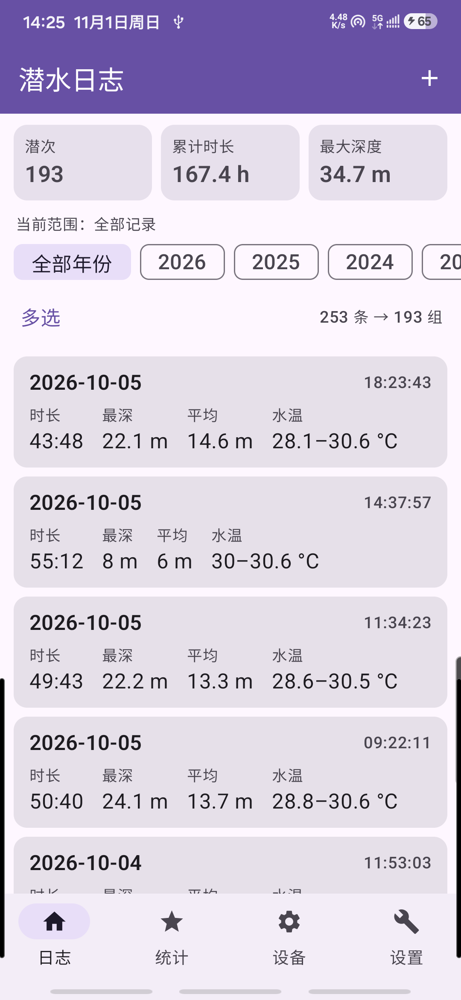
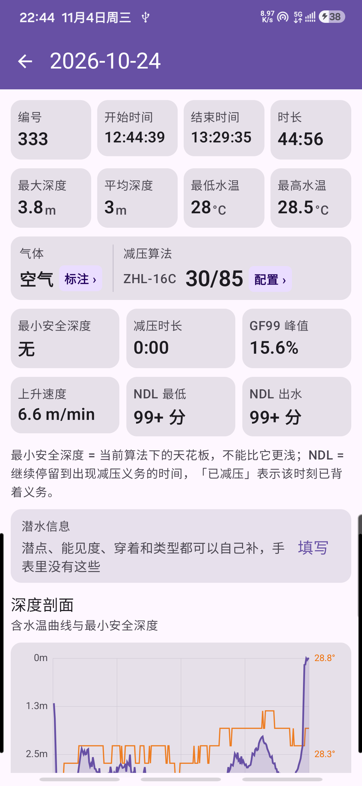
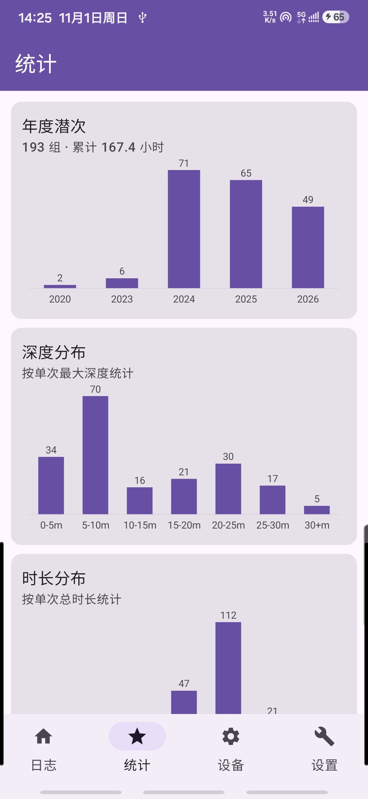
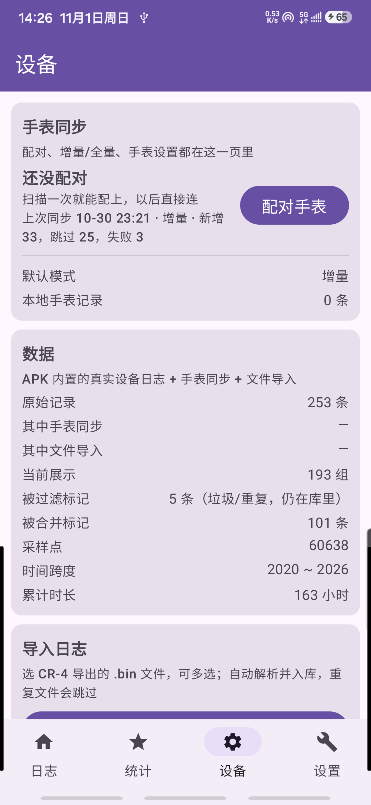

# CrestHelper

> A third-party Android client for the **Crest CR-4** dive computer — scan, connect, download, review, all self-hosted.
>
> [中文](README.md)

<p align="center">
  
  
  
  
</p>

## Why this exists

Two motivations, plus a few old annoyances fixed along the way.

### 1. Syncing was slow

The more dives you log, the worse it gets: the stock app **scans the entire logbook** before it
downloads anything, and it only works while you sit on that screen. CR-4's BLE is slow to begin
with, so one sync eats several minutes. Hence:

- **Lightweight incremental download** — no full scan. It compares log headers, picks only the
  entries the watch has but the phone does not, and pulls just those. Sync time drops from
  "the whole logbook" to "the few new dives".
- **Background download** — sync runs in a process-level engine plus a foreground service, so you
  can switch pages, switch apps or lock the phone mid-sync and follow progress from the notification.

### 2. Can a dive actually be reviewed afterwards?

The computer's algorithm is a black box to its owner: did this dive cross into
**decompression**? Was the **conservatism** at the time high or low? The watch never says.
So there is an algorithm settings page:

- **ZHL-16C** built in, with gradient factors (GF) you can set by hand, default **30/85** —
  lower the low GF to be more conservative;
- recomputes **NDL remaining**, **minimum safe depth** and the **GF99** curve from the real profile;
- look back along the curve to see where that dive crossed the deco line, and whether the
  conservatism you used was stricter than it needed to be.

### 3. Cleaning up junk records

- **Filter out very short dives** — depth/duration thresholds drop accidental triggers;
- **Merge fragments** — breaking the surface mid-dive and going back down used to land as
  several separate logs; they are stitched back into **one dive** by surface interval;
- **Nothing is really deleted** — removal only sets a flag, records and samples stay put, and
  the recycle bin can bring them back.

### Status

SCUBA mode only — freediving isn't worth the bother. Phone compatibility was only ever
tried on the author's own device; for anything else, clone it and let an AI agent debug it.
The compatibility table below has the finer boundaries.

## Compatibility & testing notice — read this first

| Item | Detail |
|---|---|
| **Target device** | **Crest CR-4**. Rebadged units sharing the same hardware (Deep Six Excursion / Genesis Centauri / Scorpena Alpha) use the same `deepsix_excursion` record format and *should* work, but were **not verified one by one** |
| **Tested on** | **Samsung Galaxy S23 only** (SM-S9110, Android 16 / API 36, arm64-v8a) |
| **Not covered** | Other phone brands/models, Android 8–14, tablets, emulators, iOS, other dive computers |
| **APK ABI** | `arm64-v8a` only (`abiFilters`) — 32-bit devices cannot install it |

> In short: **usable and verified along the CR-4 + Galaxy S23 path. Everything else counts as untested.**

## Features

| Module | Notes |
|---|---|
| Parsing | libdivecomputer's `deepsix_excursion` parser built via NDK, exposed as JSON over JNI |
| Dive list | Year filter, favourites, header stats, multi-select merge & batch delete (scoped to the current filter) |
| Recycle bin | Delete only sets `user_deleted`; records and samples stay. Restore one/many/all — **no permanent delete** |
| Dive detail | Two metric rows up top (number / start / end / duration, max & avg depth with min & max water temp); gas and deco algorithm share one card, each with its own annotate/configure action; then min safe depth, NDL remaining, GF99 and ascent rate; profile + temperature chart, with the **dive info** card above it (site, visibility, wetsuit/drysuit, terrain & water tags) |
| Settings | Merge threshold, junk thresholds, direct GF pair (default 30/85), default gas, default sync mode, recycle-bin entry |
| Statistics | Yearly/monthly counts, depth & duration histograms, surface-interval distribution |
| File import | Multi-select `.bin` via SAF, fingerprint dedupe, merged with existing data |
| Watch sync | Incremental sync by index delta with anchor fingerprint check, auto-fallback to full sync |
| Background sync | Runs in a process-level engine + foreground service; leaving the screen, switching apps or locking the phone won't interrupt it |
| Watch settings | 3-step time calibration (date / time / commit, byte-level read-back); other items flagged "not exposed by firmware" |
| Metadata | Merge, filter, delete, favourite, gas and manual annotations are all **flags**, never physical deletes |

## Layout

```
CrestHelper/
├── android/                  Android app (Kotlin + Compose + NDK)
│   ├── app/src/main/java/com/divelog/app/    UI & business logic (data/ = SQLite, sync/ = BLE)
│   ├── app/src/main/cpp/                     libdc JNI bridge + CMake
│   ├── app/src/main/res/                     icons (mipmap-*) and theme
│   ├── app/src/test/                         L1 JVM unit tests
│   ├── app/src/androidTest/                  L3 on-device instrumented tests
│   └── at.sh                                 one command for all three test layers
├── data/                     Sample dataset (dives.csv: 40 curated summaries, one row per dive)
├── raw/                      3 raw .bin samples (for validating the parse chain)
├── tools/                    Desktop scripts (probing, batch parsing, algorithm cross-check, icons, web data)
├── web/                      Phone-sized UI prototype (design first, port to Android later)
├── build/                    Standalone parser without autotools (parse_cr4.c + build.sh)
├── third_party/              libdivecomputer (parser sources, reference protocol implementation)
├── docs/                     Research / architecture / algorithms / work log / sync design / tests
└── docs/shots/               Screenshots used in this README (taken on a Galaxy S23)
```

## Building

Requires JDK 17, Android SDK (platform 35), NDK 27.0.12077973, CMake 3.22.1.

```bash
# 1) Fetch the third-party parser sources (required, or the NDK build lacks headers)
git submodule update --init --recursive

# 2) Build
cd android
./gradlew :app:assembleDebug          # or: bash at.sh build (also checks 16 KB page alignment)
./gradlew :app:assembleRelease        # signed only when android/keystore.properties exists
```

`at.sh` hardcodes no local paths: JDK resolves via `$JDK17_HOME` → `$JAVA_HOME` → common install
locations, SDK via `$ANDROID_HOME` → `$ANDROID_SDK_ROOT` → common locations, and Gradle prefers
`./gradlew`. All can be overridden with environment variables, so moving to another machine
usually needs no script edits.

> On a restricted network `assembleRelease` may stall on `lintVitalAnalyzeRelease`
> (it downloads `lint-gradle`). Add
> `-x lintVitalAnalyzeRelease -x lintVitalReportRelease -x lintVitalRelease` to skip it —
> the APK output is unaffected. Run a full lint once when the network allows.

## Testing

Three layers replace "install the APK and tap around" — see [docs/06](docs/06-自动化测试指南.md)
(docs are in Chinese).

```bash
cd android
bash at.sh          # L1 + L2 + install + L3 (L3 auto-skips when no phone is attached)
bash at.sh unit     # unit tests only, seconds
bash at.sh device   # on-device instrumented tests only
```

- **L1** JVM unit tests: decompression math, NDL, merge/filter rules, CSV, JSON tolerance,
  sync planner, and "flags survive a re-sync"
- **L2** Build: Kotlin/NDK compile, `.so` output, **16 KB page alignment**, APK packaging
- **L3** On-device: `am instrument`, captures "installs but won't open" crash stacks and JNI parse values

## Data

`data/dives.csv` holds **summaries**: one row of numbers per dive (index, start time, duration,
max depth, lowest temperature). It is imported into SQLite on first launch and backs the list,
the filters and the statistics.

It contains **40 curated samples** drawn from a real CR-4 logbook — every year from 2020 to 2026,
keeping the deepest 34.7 m, the longest 101 min, and a few one-to-two-second accidental triggers
(so the junk filter has something to show). Only the summary numbers are kept: **no dive sites, no
GPS, no per-sample profiles**.

`raw/` ships 3 representative samples (deepest 34.7 m, longest 102 min, earliest from 2020),
enough to prove the "raw bytes → parser → CSV" chain works. To re-run every `.bin`:

```bash
bash build/build.sh          # build the standalone parser first (no autotools needed)
python tools/batch_parse.py  # batch-parse raw/ and rewrite data/dives.csv
```

`tools/dctool.py` is for single-record debugging, `tools/cr4_probe.py` for GATT probing.

`web/app-data.js` is the prototype's demo dataset, produced by `tools/make_web_demo.py`:
all 40 summaries plus 6 dives with profiles, 34 KB.

## Device protocol (CR-4)

Field meanings and value ranges follow the `deepsix_excursion` parser in
[libdivecomputer](https://github.com/libdivecomputer/libdivecomputer) — that implementation is
compiled into this project's parsing layer, so it is the reference for protocol values.
CR-4 talks BLE, which libdivecomputer has no transport for, so the app implements that part.
The table below is measured:

| Item | Value |
|---|---|
| Advertised name | `Crest-CR4` (rebadges: Deep Six Excursion / Genesis Centauri / Scorpena Alpha) |
| Address type | **random private address** (Android needs this handled, or you get "Unreachable") |
| Data service | `f000ffe0-ab12-45ec-84c8-46483f4626e9` |
| Data characteristic | `f000ffe1-ab12-45ec-84c8-46483f4626e9` (notify + write) |
| Frame format | `[grp][cmd][dir][len][payload][csum]`, `csum = sum ^ 0xFF`, response group = request group + 1 |

Command groups: `0xA0` device info, `0xB0` settings (date/time/storage/load), `0xC0` logs
(count / index / header / profile).

## Known limitations

- Only the CR-4 family (`deepsix_excursion` format); other computers unsupported
- Verified on the Galaxy S23 only; please include model + Android version in bug reports
- `arm64-v8a` only, no `armeabi-v7a`
- No accounts, no cloud sync — data lives in a local SQLite database
- Older CR-4 records carry no gas information, so gas type depends on user annotation

## Disclaimer

This is a **log review tool**, not a dive planning tool. NDL, decompression times and min safe
depth recomputed here come from replaying a recorded profile with assumed parameters. They
**cannot replace your dive computer's real-time computation and must not be used for planning a
dive**. Plan with trained procedures and your own computer.

## Docs

| Doc | Content |
|---|---|
| [00](docs/00-总纲-产品路线图.md) | Goals, milestones, current progress |
| [01](docs/01-调研-libdivecomputer与Crest-CR4.md) | libdivecomputer limits, measured CR-4 GATT profile, BLE gap |
| [02](docs/02-架构设计-潜水记录管理软件.md) | Layers and data flow |
| [03](docs/03-日志分析与算法设计.md) | Merge/filter rules, ZHL-16C + GF, NDL criteria |
| [04](docs/04-工作总结-安卓原生App与自动化测试.md) | Android implementation log and pitfalls |
| [05](docs/05-数据同步与元数据设计.md) | Storage schema, incremental/full strategy, watch-setting boundaries, protocol cheat sheet |
| [06](docs/06-自动化测试指南.md) | Three test layers and `at.sh` |

## Third party & license

- [libdivecomputer](https://github.com/libdivecomputer/libdivecomputer) — LGPL-2.1; the `.so`
  links its parsers only, so you can drop in an upstream build to replace it
- [bleak](https://github.com/hbldh/bleak) — wheels under `tools/wheels/`, desktop debug scripts only

This project's own code is MIT.
