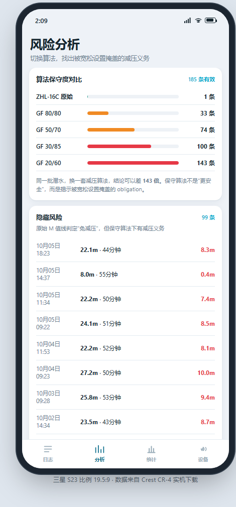

# DiveLog · CR-4 潜水日志

用自研 Android App 取代 Crest CR-4 的原厂 App：**扫描 → 连接 → 下载 → 分析** 全链路自有，
并且做到原厂 App 没有的能力——换算法重算减压、发现隐藏风险、日志合并与脏数据过滤。

原厂 App 只做搬运和列表；这个项目做**风险复盘**。

<p align="center">
  
  
  
  
</p>

---

## 功能

| 模块 | 状态 | 说明 |
|---|---|---|
| 数据解析 | ✅ | libdivecomputer 的 `deepsix_excursion` 解析器经 NDK 编译，JNI 输出 JSON |
| 日志列表 | ✅ | 年/月筛选、顶栏联动统计、多选合并、垃圾日志清理（可撤销） |
| 单次详情 | ✅ | 剖面 + 温度曲线、最大/平均深度、温度极值、**最大安全深度**与 **NDL** 实时曲线 |
| 分析 | ✅ | ZHL-16C + GF 减压内核，GF99 风险曲线，多套 GF 对拍 |
| 统计 | ✅ | 年度/月度潜次、深度与时长直方图、水面间隔分布 |
| 文件导入 | ✅ | SAF 多选 `.bin`，指纹去重，落库后与内置数据合并展示 |
| 手表同步 | ✅ | 增量按「手表最新编号 − 本地最大编号」对差，锚点指纹校验，异常自动降级全量 |
| 手表设置 | ✅ | 时间校准三步下发（写日期/时间/落盘，逐字节回读校验）；其余项按能力矩阵标注「固件未开放」 |
| 元数据 | ✅ | 原始记录全量留档，合并/过滤/删除以**标记位**落库，不物理删除 |

> 「✅」表示代码与单测齐备；手表同步的 BLE 传输层按实测 GATT 参数实现，
> 但本轮没有手表可连，**真机回归待首次连表**（见 docs/05 §6）。

## 目录

```
dive/
├── android/                  Android App（Kotlin + Compose + NDK）
│   ├── app/src/main/java/com/divelog/app/    UI 与业务
│   ├── app/src/main/cpp/                     libdc JNI 桥 + CMake
│   ├── app/src/test/                         L1 JVM 单测
│   ├── app/src/androidTest/                  L3 真机仪器测试
│   └── at.sh                                 一条命令跑完三层测试
├── data/                     内置真实数据集（dives.csv / samples.csv）
├── raw/                      292 个原始 .bin（重新解析的唯一来源）
├── tools/                    桌面端脚本（探测、下载、批量解析、算法对拍）
├── web/                      手机尺寸 UI 原型（先定 UI 再平移安卓）
├── build/                    免 autotools 的独立解析器
└── docs/                     调研 / 架构 / 算法 / 工作总结 / 测试指南
```

## 构建

环境：JDK 17、Android SDK（platform 35）、NDK 27.0.12077973、CMake 3.22.1。

```bash
# 1) 取第三方解析器（也可用工作区同级已有的 libdivecomputer/）
git submodule update --init --recursive

# 2) 构建
cd android
./gradlew :app:assembleDebug
```

`libdivecomputer` 的定位优先级：`-DLDC_ROOT=` → `third_party/libdivecomputer`（submodule）
→ 工作区同级 `../libdivecomputer`。所以本地已有 clone 时不必再拉 submodule。

## 测试

三层测试替代"装 APK 手点"，详见 [docs/06-自动化测试指南.md](docs/06-自动化测试指南.md)。

```bash
cd android
bash at.sh          # L1 + L2 + 安装 + L3（没有手机会自动跳过 L3）
bash at.sh unit     # 只跑单元测试，秒级
bash at.sh device   # 只跑真机仪器测试
```

- **L1** JVM 单测：减压数值、NDL、合并/过滤规则、CSV、JSON 容错、同步计划器
- **L2** 构建：Kotlin/NDK 编译、`.so` 产出、**16 KB 页对齐**、APK 打包
- **L3** 真机：`am instrument` 直跑，抓「装上打不开」的崩溃堆栈与 JNI 解析数值

## 数据

内置数据集来自真实设备：**253 条原始记录 → 按水面间隔合并为 198 组 → 过滤 13 条无效 → 185 条有效**，
累计约 166.5 小时水下时间。口径与 `tools/analyze.py` 完全一致，App 与脚本可互相验证。

原始 `.bin` 全部保留（`raw/`），任何时候都能重新解析；App 内亦是"原始记录不改，只打标"。

## 设备协议

CR-4 走 BLE，libdivecomputer 不含 BLE 传输层，由 App 侧实现。实测参数：

| 项 | 值 |
|---|---|
| 广播名 | `Crest-CR4`（同硬件贴牌：Deep Six Excursion / Genesis Centauri / Scorpena Alpha） |
| 地址类型 | **随机私有地址**（Android 侧连接需注意，否则 Unreachable） |
| 数据 service | `f000ffe0-ab12-45ec-84c8-46483f4626e9` |
| 数据 characteristic | `f000ffe1-ab12-45ec-84c8-46483f4626e9`（notify + write） |
| 包格式 | `[grp][cmd][dir][len][payload][csum]`，`csum = sum ^ 0xFF`，响应 group = 请求 group + 1 |

命令组：`0xA0` 设备信息、`0xB0` 设置（日期/时间/存储/加载）、`0xC0` 日志（count / index / header / profile）。

## 同步与元数据

- **增量**：读手表 `lastIndex`、本地 `maxIndex`，先用一条 header 校验锚点指纹是否一致；
  一致就只补差的那几条，不一致说明日志被清空重排，自动退回全量。
- **全量**：逐条比指纹，已存在跳过，缺失/变更才下载。
- **幂等**：入库键 `(device_id, watch_index)`，重复同步不会产生重复记录；
  单条坏数据不会中断整轮。
- **标记位**：`group_id`（合并归属）、`filter_reason`（垃圾/重复）、
  `user_deleted`（软删除）都落在 `dive` 表上，原始字节另存 `.bin`，
  所以任何视图都能重建，数据本身永不丢。

细节见 [docs/05-数据同步与元数据设计.md](docs/05-数据同步与元数据设计.md)。

## 文档

| 文档 | 内容 |
|---|---|
| [00-总纲](docs/00-总纲-产品路线图.md) | 产品目标、里程碑、当前进度 |
| [01-调研](docs/01-调研-libdivecomputer与Crest-CR4.md) | libdivecomputer 能力边界、CR-4 的 GATT 实测、BLE 缺口 |
| [02-架构设计](docs/02-架构设计-潜水记录管理软件.md) | 分层与数据流 |
| [03-日志分析与算法设计](docs/03-日志分析与算法设计.md) | 合并/过滤口径、ZHL-16C + GF、NDL 判据 |
| [04-工作总结](docs/04-工作总结-安卓原生App与自动化测试.md) | 安卓端落地过程与踩坑 |
| [05-同步与元数据](docs/05-数据同步与元数据设计.md) | 存储 schema、增量/全量策略、手表设置边界、协议速查 |
| [06-自动化测试指南](docs/06-自动化测试指南.md) | 三层测试与 `at.sh` 用法 |

## 第三方

- [libdivecomputer](https://github.com/libdivecomputer/libdivecomputer) —— LGPL-2.1，`.so` 只链接其解析器
- [bleak](https://github.com/hbldh/bleak)（`tools/wheels/`，仅桌面端调试脚本用）

本项目自身代码采用 MIT。
