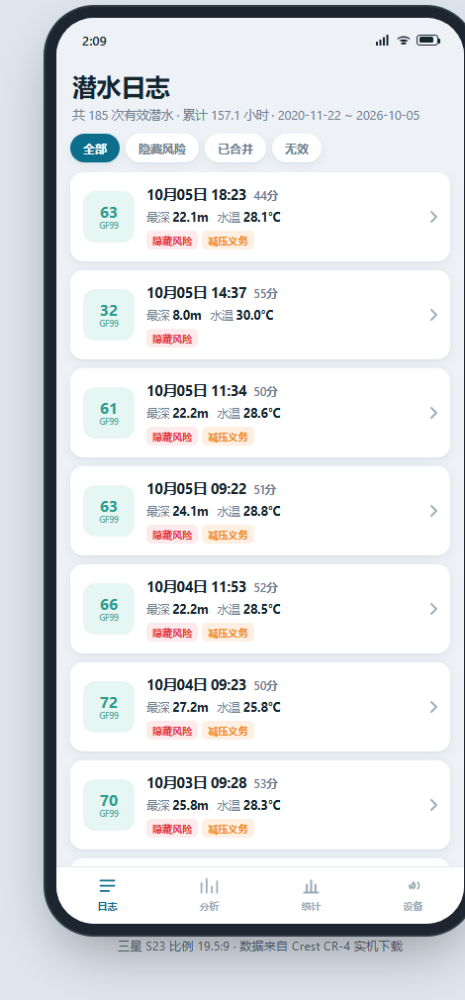
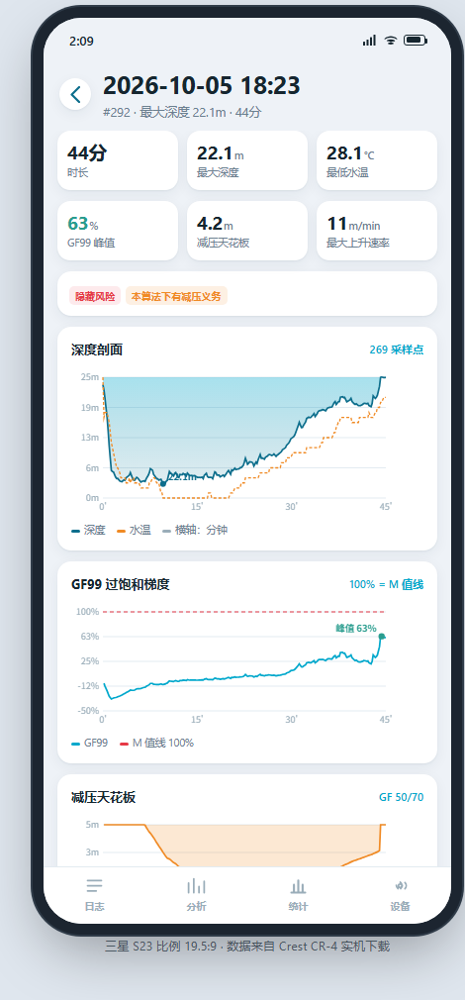
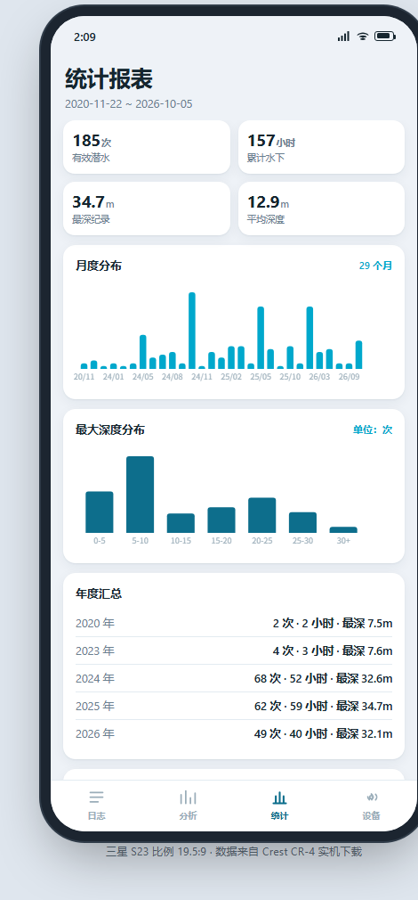
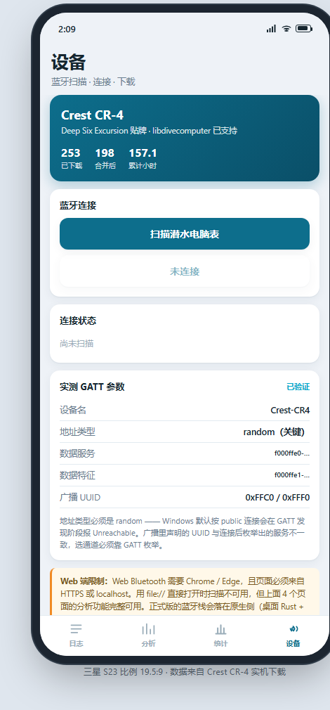

# CrestHelper

> 为 **Crest CR-4** 潜水电脑写的第三方 Android 客户端：扫描 → 连接 → 下载 → 复盘全链路自有。
> A third-party Android client for the **Crest CR-4** dive computer — scan, connect, download, review, all self-hosted.

[中文](#-中文) · [English](#-english)

<p align="center">
  
  
  
  
</p>

---

# 📖 中文

## 适配与测试声明（先读这段）

| 项 | 说明 |
|---|---|
| **适配设备** | **Crest CR-4**。同硬件贴牌机（Deep Six Excursion / Genesis Centauri / Scorpena Alpha）走同一套 `deepsix_excursion` 记录格式，理论上通用，但**未逐台验证** |
| **实测机型** | **仅三星 Galaxy S23（SM-S9110，Android 16 / API 36，arm64-v8a）** |
| **未覆盖** | 其他品牌/型号手机、Android 8~14 各版本、平板、模拟器、iOS、其他潜水表 |
| **APK 架构** | 只编 `arm64-v8a`（`abiFilters`），32 位设备装不上 |
| **功能验证度** | 导入 / 解析 / 列表 / 详情 / 统计 / 回收站 / 设置：S23 实机跑通；BLE 直连同步：代码与 GATT 实测参数齐备，但**尚未在有表在场时跑完整回归** |

> 一句话：**在 CR-4 + 三星 S23 这条路径上验证可用，别的一律按"未测"对待。**

## 它解决什么问题

原厂 App 只做搬运和列表；这个项目做**风险复盘**：

- 换减压算法重算（ZHL-16C + GF，默认 **30/85**，随时可改）
- 用真实剖面重算 **NDL** 与最大安全深度曲线
- 按水面间隔合并碎记录、识别并过滤脏数据
- 原始记录全量留档 —— 删除只是打标记，随时从回收站捞回来

## 功能

| 模块 | 状态 | 说明 |
|---|---|---|
| 数据解析 | ✅ | libdivecomputer 的 `deepsix_excursion` 解析器经 NDK 编译，JNI 输出 JSON |
| 日志列表 | ✅ | 年/月筛选、收藏筛选、顶栏联动统计、多选合并与**批量删除**（作用域=当前筛选结果）；只吃摘要，剖面后台分块载入 |
| 回收站 | ✅ | 删除只打 `user_deleted` 标记，原始记录与采样点都还在；可单条/多选/全部恢复，**不提供彻底删除** |
| 单次详情 | ✅ | 剖面 + 温度曲线、最大/平均深度、温度极值、**最大安全深度**与 **NDL** 实时曲线、气体标注、GF 就地调 |
| 设置 | ✅ | 合并阈值、垃圾阈值、**GF 两个值直配**（默认 30/85）、默认气体、同步默认模式、回收站入口 |
| 统计 | ✅ | 年度/月度潜次、深度与时长直方图、水面间隔分布 |
| 文件导入 | ✅ | SAF 多选 `.bin`，指纹去重，落库后与内置数据合并展示 |
| 手表同步 | ✅ | 增量按「手表最新编号 − 本地最大编号」对差，锚点指纹校验，异常自动降级全量 |
| 后台同步 | ✅ | 同步跑在进程级引擎 + 前台服务里，退出页面/切 App/锁屏都不中断，通知栏看进度 |
| 手表设置 | ✅ | 时间校准三步下发（写日期/时间/落盘，逐字节回读校验）；其余项按能力矩阵标注「固件未开放」 |
| 元数据 | ✅ | 合并/过滤/删除/收藏/气体都以**标记位**落库，不物理删除 |
| 配对 | ✅ | 手表地址持久化，下次直连不用重扫 |
| 分析页 | 🚧 | ZHL-16C + GF 内核与 GF99 曲线已就绪，但页面要等整条剖面到齐才算，先不挂导航 |

> 「✅」= 代码与单测齐备。BLE 同步的传输层按实测 GATT 参数实现，
> 但尚未在有表在场时跑完整回归（见 [docs/05 §6](docs/05-数据同步与元数据设计.md)）。

## 拿一个装得上的 APK

已构建并留档的安装包（**Galaxy S23 实机验证的那条构建线**，未签入仓库，走 Release 发）：

```
dist/CrestHelper-0.1.0-arm64-v8a.apk         # release，已签名，可直接装
dist/CrestHelper-0.1.0-arm64-v8a-debug.apk   # debug，带日志，排查用
```

```bash
adb install -r dist/CrestHelper-0.1.0-arm64-v8a.apk
```

发布成 GitHub Release（APK 不进 git 历史，`dist/` 已 gitignore）：

```bash
gh release create v0.1.0 dist/*.apk \
  --title "CrestHelper v0.1.0" \
  --notes "适配 Crest CR-4；仅在三星 Galaxy S23（SM-S9110，Android 16）实机验证。"
```

> **签名密钥**在 `android/keystore/cresthelper-release.jks`，口令在 `android/keystore.properties`
> （两者都已 gitignore）。**请自行备份** —— 丢了就无法给已安装用户推送更新。

## 目录

```
CrestHelper/
├── android/                  Android App（Kotlin + Compose + NDK）
│   ├── app/src/main/java/com/divelog/app/    UI 与业务（data/ 为 SQLite 层，sync/ 为 BLE 同步）
│   ├── app/src/main/cpp/                     libdc JNI 桥 + CMake
│   ├── app/src/main/res/                     图标（mipmap-*）与主题
│   ├── app/src/test/                         L1 JVM 单测
│   ├── app/src/androidTest/                  L3 真机仪器测试
│   └── at.sh                                 一条命令跑完三层测试
├── data/                     内置真实数据集（dives.csv 入库；samples.csv 本地生成、不入库）
├── raw/                      294 个原始 .bin（重新解析的唯一来源）
├── tools/                    桌面端脚本（探测、批量解析、算法对拍、图标生成）
├── web/                      手机尺寸 UI 原型（先定 UI 再平移安卓）
├── build/                    免 autotools 的独立解析器（parse_cr4.c + build.sh）
├── third_party/              libdivecomputer（git submodule，pin 9e6c3c8）
└── docs/                     调研 / 架构 / 算法 / 工作总结 / 同步设计 / 测试指南
```

## 构建

环境：JDK 17、Android SDK（platform 35）、NDK 27.0.12077973、CMake 3.22.1。

```bash
# 1) 取第三方解析器（submodule，不是可选步骤）
git submodule update --init --recursive

# 2) 构建
cd android
./gradlew :app:assembleDebug          # 或 bash at.sh build（含 16 KB 页对齐校验）
./gradlew :app:assembleRelease        # 需要 android/keystore.properties 才会签名
```

`at.sh` 不硬编码本机路径：JDK 依次找 `$JDK17_HOME` → `$JAVA_HOME` → 常见安装位置，
SDK 找 `$ANDROID_HOME` → `$ANDROID_SDK_ROOT` → 常见安装位置，Gradle 优先 `./gradlew`。
都能用环境变量覆盖，换机器通常不用改脚本。

> 网络受限时 `assembleRelease` 可能卡在 `lintVitalAnalyzeRelease`（要拉 `lint-gradle`）：
> 加 `-x lintVitalAnalyzeRelease -x lintVitalReportRelease -x lintVitalRelease` 跳过即可，
> 不影响产物；有网时建议跑一次完整 lint。

## 关于 libdivecomputer：它是 submodule，不是被删掉

```
third_party/libdivecomputer → https://github.com/libdivecomputer/libdivecomputer.git
                                pin 9e6c3c8 "Add missing fields to the i770R parser"
```

- **源码被"抽"出去了，但没丢**：主仓库不再拷贝 132 个 `.c`，改成一个 gitlink 指向 upstream
  的固定 commit。构建时 CMake 照常把这些源码编进 `libdcbridge.so`。
- **pin 的是上游真实提交**，不是本地魔改；子模块 `git status` 干净，
  所以 `git submodule update --init` 谁 clone 谁都能复现同一份解析器。
- **为什么这么做**：第三方代码跟着 upstream 走，主仓库 diff 里永远不出现它的噪声；
  升级 = 换 pin 的 commit 一行 diff 就能看清。
- **代价**：想改 `deepsix_excursion.c` 的协议解析，改动进不了主仓库历史 ——
  得提到上游 fork，再在主仓库改 pin。这也是本项目只做「读」的原因。
- **CMake 三级回退**（`android/app/src/main/cpp/CMakeLists.txt`）：
  `-DLDC_ROOT=` → `third_party/libdivecomputer`（submodule）→ 工作区同级 `../libdivecomputer`。
  本地已有 clone 时不必再拉 submodule。

## 测试

三层测试替代"装 APK 手点"，详见 [docs/06-自动化测试指南.md](docs/06-自动化测试指南.md)。

```bash
cd android
bash at.sh          # L1 + L2 + 安装 + L3（没有手机会自动跳过 L3）
bash at.sh unit     # 只跑单元测试，秒级
bash at.sh device   # 只跑真机仪器测试
```

- **L1** JVM 单测：减压数值、NDL、合并/过滤规则、CSV、JSON 容错、同步计划器
- **L2** 构建：Kotlin/NDK 编译、`.so` 产出、**16 KB 页对齐**、APK 打包
- **L3** 真机：`am instrument` 直跑，抓「装上打不开」的崩溃堆栈与 JNI 解析数值
  （S23 上一次跑 **19/19 通过**，约 22 秒）

## 数据

内置数据集来自真实设备：**253 条原始记录 → 按水面间隔合并为 198 组 → 过滤 13 条无效 → 185 条有效**，
累计约 166.5 小时水下时间。口径与 `tools/analyze.py` 完全一致，App 与脚本可互相验证。

### `samples.csv` 不入库

`samples.csv` 是**逐点剖面**（每条潜水每 10 秒一个点），属于个人潜水轨迹，
已经在 `.gitignore` 里排除，`git clone` 下来不会带这个文件。缺了它 App 照样能跑：
列表、统计、筛选、同步全部正常，只是详情页**没有剖面曲线**（`nsamples` 归零，不会卡在"载入中"）。

要补回来，从 `raw/` 重新生成一份、再复制进 assets：

```bash
python tools/batch_parse.py            # 产出 data/dives.csv + data/samples.csv
cp data/samples.csv android/app/src/main/assets/
```

`dives.csv`（253 行摘要，31 KB）是入库的，所以开箱就有数据可看。

### `samples.csv` 为什么有 3 MB

| 项 | 数值 |
|---|---|
| 文件大小 | 3.02 MB |
| 行数（采样点） | 60,638 |
| 覆盖潜水 | 253 条，平均 ~240 点/条（10 秒一个点） |
| 每行平均 | 49.9 字节，格式 `file,t_sec,depth_m,temp_c` |
| 其中文件名列 | **约 2.1 MB（70%）** —— `.bin` 文件名约 35 字符，一模一样的字符串重复了 6 万遍 |
| 去掉 `file` 列 | 只剩 **0.86 MB** |
| gzip 后 | 约 0.3 MB |

结论：**大不是因为数据多，是因为每行都塞了一遍文件名**。6 万个采样点按 4 列纯文本展开，
本来就接近 1 MB——这是"逐点剖面"这种数据的正常体量（253 条 × 240 点 × 10 秒 ≈ 166 小时）。

之所以没做紧凑化（去掉 `file` 列 / 改二进制 / 存 gzip），是为了 **人工可读 + 可直接 diff 对拍**：
它是桌面端脚本与 App 共用的中间产物，出问题时拿 Excel 打开就能看。
真嫌大，把 `file` 列换成记录序号即可掉到 0.86 MB —— 需要的话再动，属于可选项不是缺陷。

> `raw/` 里比内置数据集多出的部分是后续补下的历史日志（含 2 组重复下载，内容 md5 相同），
> 内置数据集是更早的 253 条快照。重跑 `tools/batch_parse.py` 会得到 294 条 ——
> 想让 App 吃全量，就把新的 `dives.csv` / `samples.csv` 复制进 `android/app/src/main/assets/`。

## 设备协议（CR-4）

CR-4 走 BLE，libdivecomputer 不含 BLE 传输层，由 App 侧实现。实测参数：

| 项 | 值 |
|---|---|
| 广播名 | `Crest-CR4`（同硬件贴牌：Deep Six Excursion / Genesis Centauri / Scorpena Alpha） |
| 地址类型 | **随机私有地址**（Android 侧连接需注意，否则 Unreachable） |
| 数据 service | `f000ffe0-ab12-45ec-84c8-46483f4626e9` |
| 数据 characteristic | `f000ffe1-ab12-45ec-84c8-46483f4626e9`（notify + write） |
| 包格式 | `[grp][cmd][dir][len][payload][csum]`，`csum = sum ^ 0xFF`，响应 group = 请求 group + 1 |

命令组：`0xA0` 设备信息、`0xB0` 设置（日期/时间/存储/加载）、`0xC0` 日志（count / index / header / profile）。

## 加载策略：摘要先出，剖面后到

首屏只读 `dive` 表（一条记录一行），平均深度/水温极值/气体种类数都在入库时算好存成列，
所以 253 条还是 3 千条都是几十毫秒出列表。六万个采样点走独立通道**分块载入**
（默认每批 40 条，按时间倒序），列表底下显示「剖面 40/253」一路往前爬；
点进某一条时只补那一条（`ensure`，几毫秒），所以直接翻到 2019 年也不用等全量。

## 气体：能读到吗

**手上这 294 条读不到**。它们全是 CR-4 的 v0 记录格式，实测 `gasmixCount` 全 0、
也没有任何气体切换事件 —— 格式里就没有这个字段，不是解析器没做。
所以按三层取值：**用户标注 > 记录自带 > 全局默认**，并且气体真的会喂进减压模型
（30 m / GF 50/70 下空气 6 分钟、EAN32 9 分钟）。

## 已知限制

- 只认 CR-4 系（含贴牌）的 `deepsix_excursion` 记录格式，别的表不支持
- 只在 Galaxy S23 上验证过；其他机型未测，遇到问题请附机型 + Android 版本
- 只出 `arm64-v8a`，不含 `armeabi-v7a`
- 无账号、无云同步，数据全在手机本地 SQLite
- 气体信息依赖用户标注（见上）

## 免责声明

本项目是**日志复盘工具**，不是潜水计划工具。App 内重算的 NDL、减压时间、最大安全深度
全部基于事后回放的剖面与假设参数，**不能替代潜水电脑的实时计算，也不能作为下水前的计划依据**。
任何潜水决策请以受过训练的潜水计划方法与你自己的潜水电脑为准。

## 文档

| 文档 | 内容 |
|---|---|
| [00-总纲](docs/00-总纲-产品路线图.md) | 产品目标、里程碑、当前进度 |
| [01-调研](docs/01-调研-libdivecomputer与Crest-CR4.md) | libdivecomputer 能力边界、CR-4 的 GATT 实测、BLE 缺口 |
| [02-架构设计](docs/02-架构设计-潜水记录管理软件.md) | 分层与数据流 |
| [03-日志分析与算法设计](docs/03-日志分析与算法设计.md) | 合并/过滤口径、ZHL-16C + GF、NDL 判据 |
| [04-工作总结](docs/04-工作总结-安卓原生App与自动化测试.md) | 安卓端落地过程与踩坑 |
| [05-同步与元数据](docs/05-数据同步与元数据设计.md) | 存储 schema、增量/全量策略、手表设置边界、协议速查 |
| [06-自动化测试指南](docs/06-自动化测试指南.md) | 三层测试与 `at.sh` 用法 |

## 第三方与许可

- [libdivecomputer](https://github.com/libdivecomputer/libdivecomputer) —— LGPL-2.1，
  `.so` 只链接其解析器；按其许可要求，替换 `.so` 即可换回上游版本
- [bleak](https://github.com/hbldh/bleak)（`tools/wheels/`，仅桌面端调试脚本用）

本项目自身代码采用 MIT。

---

# 📖 English

## Compatibility & testing notice — read this first

| Item | Detail |
|---|---|
| **Target device** | **Crest CR-4**. Rebadged units sharing the same hardware (Deep Six Excursion / Genesis Centauri / Scorpena Alpha) use the same `deepsix_excursion` record format and *should* work, but were **not verified one by one** |
| **Tested on** | **Samsung Galaxy S23 only** (SM-S9110, Android 16 / API 36, arm64-v8a) |
| **Not covered** | Other phone brands/models, Android 8–14, tablets, emulators, iOS, other dive computers |
| **APK ABI** | `arm64-v8a` only (`abiFilters`) — 32-bit devices cannot install it |
| **How much is verified** | Import / parsing / list / detail / stats / recycle bin / settings: verified on a real S23. BLE direct sync: code and measured GATT parameters are in place, but **no full regression has been run with a watch physically present** |

> In short: **usable and verified along the CR-4 + Galaxy S23 path. Everything else counts as untested.**

## What it is for

The stock app only moves data around and lists it. This project is for **risk review**:

- Recompute decompression with your own algorithm (ZHL-16C + GF, default **30/85**, adjustable at any time)
- Recompute **NDL** and max-safe-depth curves from the real profile
- Merge fragmented logs by surface interval, detect and filter junk records
- Everything is archived — deleting only sets a flag, and you can restore from the recycle bin

## Features

| Module | Status | Notes |
|---|---|---|
| Parsing | ✅ | libdivecomputer's `deepsix_excursion` parser built via NDK, exposed as JSON over JNI |
| Dive list | ✅ | Year/month filters, favourites, header stats, multi-select merge & **batch delete** (scoped to the current filter); reads summary rows only, profiles stream in the background |
| Recycle bin | ✅ | Delete only sets `user_deleted`; records and samples stay. Restore one/many/all — **no permanent delete** |
| Dive detail | ✅ | Profile + temperature, max/avg depth, temperature extremes, **max safe depth** and **NDL** curves, gas annotation, in-place GF editing |
| Settings | ✅ | Merge threshold, junk thresholds, **direct GF pair** (default 30/85), default gas, default sync mode, recycle-bin entry |
| Statistics | ✅ | Yearly/monthly counts, depth & duration histograms, surface-interval distribution |
| File import | ✅ | Multi-select `.bin` via SAF, fingerprint dedupe, merged with bundled data |
| Watch sync | ✅ | Incremental sync by index delta with anchor fingerprint check, auto-fallback to full sync |
| Background sync | ✅ | Runs in a process-level engine + foreground service; leaving the screen, switching apps or locking the phone won't interrupt it |
| Watch settings | ✅ | 3-step time calibration (date / time / commit, byte-level read-back); other items flagged "not exposed by firmware" |
| Metadata | ✅ | Merge / filter / delete / favourite / gas are all **flags**, never physical deletes |
| Pairing | ✅ | Watch address persisted, no re-scanning needed |
| Analysis page | 🚧 | ZHL-16C + GF kernel and GF99 curve are ready; the page needs the whole profile and is not wired into navigation yet |

## Installable APK

Prebuilt packages, kept from the build line verified on the Galaxy S23 (not committed — `dist/` is gitignored):

```
dist/CrestHelper-0.1.0-arm64-v8a.apk         # release, signed, install directly
dist/CrestHelper-0.1.0-arm64-v8a-debug.apk   # debug, verbose logging
```

```bash
adb install -r dist/CrestHelper-0.1.0-arm64-v8a.apk
```

Publish as a GitHub Release:

```bash
gh release create v0.1.0 dist/*.apk \
  --title "CrestHelper v0.1.0" \
  --notes "Built for Crest CR-4; verified only on a Samsung Galaxy S23 (SM-S9110, Android 16)."
```

> **Signing key**: `android/keystore/cresthelper-release.jks`, credentials in
> `android/keystore.properties` (both gitignored). **Back them up** — losing them means you
> can never ship an update to already-installed users.

## Layout

```
CrestHelper/
├── android/                  Android app (Kotlin + Compose + NDK)
│   ├── app/src/main/java/com/divelog/app/    UI & business logic (data/ = SQLite, sync/ = BLE)
│   ├── app/src/main/cpp/                     libdc JNI bridge + CMake
│   ├── app/src/test/                         L1 JVM unit tests
│   ├── app/src/androidTest/                  L3 on-device instrumented tests
│   └── at.sh                                 one command for all three test layers
├── data/                     Bundled real dataset (dives.csv tracked; samples.csv local-only)
├── raw/                      294 raw .bin dumps (the only source for re-parsing)
├── tools/                    Desktop scripts (probing, batch parsing, algorithm cross-check, icons)
├── web/                      Phone-sized UI prototype (design first, port to Android later)
├── build/                    Standalone parser without autotools (parse_cr4.c + build.sh)
├── third_party/              libdivecomputer (git submodule, pinned to 9e6c3c8)
└── docs/                     Research / architecture / algorithms / work log / sync design / tests
```

## Building

Requires JDK 17, Android SDK (platform 35), NDK 27.0.12077973, CMake 3.22.1.

```bash
# 1) Fetch the third-party parser (submodule — not optional)
git submodule update --init --recursive

# 2) Build
cd android
./gradlew :app:assembleDebug          # or: bash at.sh build (also checks 16 KB page alignment)
./gradlew :app:assembleRelease        # signed only when android/keystore.properties exists
```

> On a restricted network `assembleRelease` may stall on `lintVitalAnalyzeRelease`
> (it downloads `lint-gradle`). Add
> `-x lintVitalAnalyzeRelease -x lintVitalReportRelease -x lintVitalRelease` to skip it —
> the APK output is unaffected. Run a full lint once when the network allows.

## About libdivecomputer: a submodule, not a deletion

```
third_party/libdivecomputer → https://github.com/libdivecomputer/libdivecomputer.git
                                pinned to 9e6c3c8 "Add missing fields to the i770R parser"
```

- **The sources were extracted from the main repo, not removed.** Instead of copying 132 `.c`
  files, the repo stores a gitlink to a fixed upstream commit. CMake still compiles those
  sources into `libdcbridge.so` at build time.
- **The pin is a real upstream commit**, not a local fork; the submodule working tree is clean,
  so anyone running `git submodule update --init` gets byte-identical parser code.
- **Why**: third-party code follows upstream, so its noise never shows up in this repo's diff.
  Upgrading is a one-line pin change, visible in review.
- **The cost**: patching `deepsix_excursion.c` would not land in this repo's history — you'd
  have to push it to an upstream fork and move the pin here. That is also why this project is read-only.
- **Three-level fallback** in `android/app/src/main/cpp/CMakeLists.txt`:
  `-DLDC_ROOT=` → `third_party/libdivecomputer` (submodule) → sibling `../libdivecomputer`.

## Testing

Three layers replace "install the APK and tap around" — see [docs/06](docs/06-自动化测试指南.md).

```bash
cd android
bash at.sh          # L1 + L2 + install + L3 (L3 auto-skips when no phone is attached)
bash at.sh unit     # unit tests only, seconds
bash at.sh device   # on-device instrumented tests only
```

- **L1** JVM unit tests: decompression math, NDL, merge/filter rules, CSV, JSON tolerance, sync planner
- **L2** Build: Kotlin/NDK compile, `.so` output, **16 KB page alignment**, APK packaging
- **L3** On-device: `am instrument`, captures "installs but won't open" crash stacks and JNI parse values
  (last full run on the S23: **19/19 passed**, ~22 s)

## Data

Bundled dataset comes from a real device: **253 raw records → merged by surface interval into
198 groups → 13 invalid filtered out → 185 valid dives**, ≈166.5 hours underwater. The ruleset is
identical to `tools/analyze.py`, so the app and the script can cross-check each other.

### `samples.csv` is not in the repo

`samples.csv` holds the **per-sample profiles** (one point every 10 s per dive) — that is personal
dive-track data, so it is listed in `.gitignore` and will not be part of a `git clone`. The app
runs fine without it: list, statistics, filters and sync all work; the detail view simply has
**no profile curves** (`nsamples` is zeroed, so it never hangs on "loading profile").

Regenerate it from `raw/` and copy it into assets:

```bash
python tools/batch_parse.py            # writes data/dives.csv + data/samples.csv
cp data/samples.csv android/app/src/main/assets/
```

`dives.csv` (253 summary rows, 31 KB) *is* tracked, so a fresh clone still has data to browse.

### Why is `samples.csv` 3 MB?

| Item | Value |
|---|---|
| File size | 3.02 MB |
| Rows (samples) | 60,638 |
| Dives covered | 253 — ~240 samples each (one point every 10 s) |
| Average row | 49.9 bytes, format `file,t_sec,depth_m,temp_c` |
| Filename column | **~2.1 MB (70%)** — the same ~35-char `.bin` name repeated 60k times |
| Without the `file` column | **0.86 MB** |
| Gzipped | ~0.3 MB |

So it is not "a lot of data" — it is one repeated filename per row. 60k samples expanded into
four plain-text columns is naturally close to 1 MB; that is the normal size of a per-sample
profile (253 dives × 240 points × 10 s ≈ 166 hours).

It was deliberately left verbose (rather than dropping the `file` column, switching to binary,
or storing gzip) because this file is the **shared intermediate artifact** between the desktop
scripts and the app: human-readable and directly diffable. If size ever matters, replacing the
`file` column with a record index drops it to 0.86 MB — an option, not a defect.

> `raw/` contains more than the bundled dataset: extra historical logs downloaded later (including
> 2 duplicate downloads with identical md5). Re-running `tools/batch_parse.py` yields 294 records;
> copy the new `dives.csv` / `samples.csv` into `android/app/src/main/assets/` to use the full set.

## Device protocol (CR-4)

CR-4 uses BLE, and libdivecomputer has no BLE transport, so the app implements it:

| Item | Value |
|---|---|
| Advertised name | `Crest-CR4` (rebadges: Deep Six Excursion / Genesis Centauri / Scorpena Alpha) |
| Address type | **random private address** (Android needs this handled, or you get "Unreachable") |
| Data service | `f000ffe0-ab12-45ec-84c8-46483f4626e9` |
| Data characteristic | `f000ffe1-ab12-45ec-84c8-46483f4626e9` (notify + write) |
| Frame format | `[grp][cmd][dir][len][payload][csum]`, `csum = sum ^ 0xFF`, response group = request group + 1 |

Command groups: `0xA0` device info, `0xB0` settings (date/time/storage/load), `0xC0` logs
(count / index / header / profile).

## Loading strategy: summaries first, profiles later

The first screen reads only the `dive` table, one row per dive — average depth, temperature
extremes and gas count are computed once at import time and stored as columns, so 253 rows or
3,000 rows both list in tens of milliseconds. The 60k samples stream through a separate channel in
chunks (40 dives per batch, newest first) with a "profiles 40/253" indicator. Opening a single dive
only fetches that one (`ensure`, a few ms), so jumping back to 2019 never waits for the whole set.

## Can gas be read?

**Not from the 294 records at hand.** They are all CR-4 v0 records: `gasmixCount` is 0 and there
are no gas-switch events — the field simply does not exist in that format. Gas therefore resolves
as **user annotation > record-provided > global default**, and it really feeds the decompression
model (at 30 m with GF 50/70: air 6 min, EAN32 9 min).

## Known limitations

- Only the CR-4 family (`deepsix_excursion` format); other computers unsupported
- Verified on the Galaxy S23 only; please include model + Android version in bug reports
- `arm64-v8a` only, no `armeabi-v7a`
- No accounts, no cloud sync — data lives in a local SQLite database
- Gas metadata depends on user annotation (see above)

## Disclaimer

This is a **log review tool**, not a dive planning tool. NDL, decompression times and max safe
depth recomputed here come from replaying a recorded profile with assumed parameters. They
**cannot replace your dive computer's real-time computation and must not be used for planning a
dive**. Plan with trained procedures and your own computer.

## License

Project code is MIT. Bundles [libdivecomputer](https://github.com/libdivecomputer/libdivecomputer)
(LGPL-2.1, parsers only, linked into a `.so` that can be replaced with an upstream build) and
[bleak](https://github.com/hbldh/bleak) (wheels under `tools/wheels/`, desktop debug scripts only).
